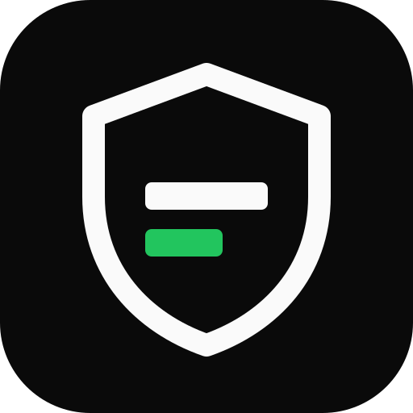

<p align="center">
  
</p>

<h1 align="center">proxshield</h1>

<p align="center">
  A self-hosted firewall for LLM apps. It redacts personal data before it reaches the model,<br>
  puts it back in the reply, and blocks prompt injection, including injection hidden in tool results.
</p>

<p align="center">
  <a href="https://github.com/aryan-tah/proxshield/actions/workflows/ci.yml"></a>
  <a href="https://www.npmjs.com/package/proxshield"></a>
  <a href="LICENSE"></a>
  <a href="https://proxshield.aryantah.com"></a>
</p>

---

Your app sends this to OpenAI:

```text
Email Jordan Lee at jordan@acme.com about card 4111 1111 1111 1111
```

With proxshield in between, OpenAI receives this:

```text
Email [PERSON_1] at [EMAIL_1] about card [CREDIT_CARD_1]
```

and your app still gets a reply with the real name, email and card number in it, including inside tool-call arguments and streamed responses. Change one URL; nothing else in your code changes.

## Why

Since 2025 the companies selling this layer have been bought: Check Point acquired Lakera, Palo Alto Networks acquired Protect AI, and OpenAI is acquiring Promptfoo. Protect AI's open-source scanner, [LLM Guard](https://github.com/protectai/llm-guard), was archived on July 8, 2026 and still gets more than 100,000 downloads a month. proxshield is an open replacement you run yourself, and it answers both Lakera Guard's and LLM Guard's APIs so existing clients can switch by URL.

## Quick start

```bash
docker run -p 8080:8080 ghcr.io/aryan-tah/proxshield
```

```ts
import OpenAI from "openai";

const openai = new OpenAI({ baseURL: "http://localhost:8080/v1" }); // your OpenAI key passes through
```

Anthropic works the same way (`baseURL: "http://localhost:8080"`). Every response carries `x-proxshield-redacted` (for example `EMAIL=1,PERSON=2`) and `x-proxshield-injection-score`.

Using the [Vercel AI SDK](https://ai-sdk.dev)? Skip the proxy and run it in-process:

```ts
import { wrapLanguageModel } from "ai";
import { proxshieldMiddleware } from "proxshield/ai-sdk";

const model = wrapLanguageModel({ model: openai("gpt-5"), middleware: proxshieldMiddleware() });
```

Try it on any text without an LLM call:

```bash
npx proxshield scan "Hi, I'm Jordan Lee. Call me at (415) 555-0132."
```

## What it does

- **Finds personal data three ways.** Patterns with validity checks for structured data (Luhn for cards, mod-97 for IBANs, libphonenumber for phones, never-issued ranges for SSNs, 11 published API key formats plus private keys, JWTs and connection-string passwords). A small NER model for names. Or OpenAI's [Privacy Filter](https://huggingface.co/openai/privacy-filter), which also finds street addresses and account numbers.
- **Round-trips placeholders.** The same value gets the same placeholder across the whole conversation, and placeholders split across streamed chunks are put back correctly. Secrets are masked and never restored.
- **Blocks injection where it actually comes from.** User messages and tool results are checked with rules (including invisible Unicode tag smuggling and lookalike letters) and Meta's Llama Prompt Guard 2. Tool results are also scored a few sentences at a time, so one planted instruction in a long document isn't averaged away.
- **Drop-in for four APIs.** OpenAI Chat Completions, Anthropic Messages, Lakera Guard `/v2/guard`, and LLM Guard's `/analyze` and `/scan` endpoints.
- **Fails safe.** Routes it doesn't scan return 404 instead of being forwarded. It logs counts and scores, never text.

## How well it works

From the [benchmark](https://proxshield.aryantah.com/reference/benchmark/), run on public and synthetic data on a laptop CPU (`npm run bench` reproduces it):

| | Default | Alternative |
| --- | --- | --- |
| Personal values redacted (552 synthetic values) | 83.0% | 97.8% with Privacy Filter |
| Gandalf injection attacks caught | 93.8% | 100% with Protect AI's model |
| Injections hidden in documents caught | 27% | 51% with Protect AI's model |
| False alarms on 400 ordinary instructions | 0 | 0 |
| False alarms on 50 customer-support messages | 2 | 13 with Protect AI's model |
| Added latency per chat message | about 15 ms | about 50 ms with Privacy Filter |

The default favors few false alarms over catching everything. Protect AI's model, the one LLM Guard used, catches more but flagged "Please use my Visa for the order" as an attack. Both are one setting away. The [limitations page](https://proxshield.aryantah.com/reference/limitations/) lists what it doesn't catch.

## Documentation

[proxshield.aryantah.com](https://proxshield.aryantah.com) covers configuration (what to redact, mask or block), deployment, each integration, migrating from LLM Guard and Lakera, and the HTTP API.

## Contributing

Missed detections, false alarms and clients that break are the most useful reports. See [CONTRIBUTING.md](CONTRIBUTING.md). Issues tagged `good first issue` are scoped for a first PR.

## License

Apache-2.0. The default injection model, Llama Prompt Guard 2, is under the Llama 4 Community License (Built with Llama); set `injection.model = "protectai"` for an all-permissive stack. See [NOTICE](NOTICE) for every model's license.
